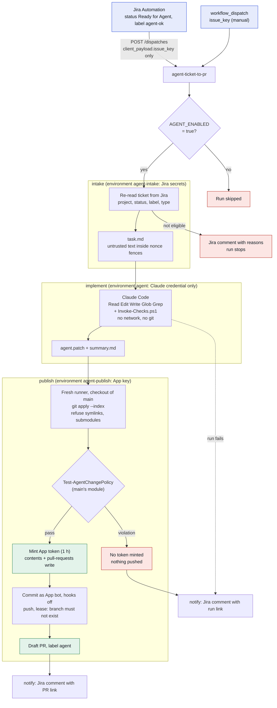
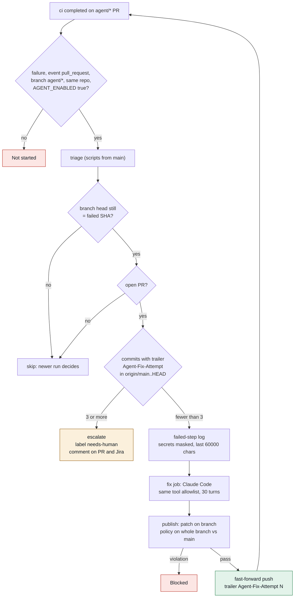

# Design

How the agent workflow is built and why. Numbered choices are in [docs/DECISIONS.md](docs/DECISIONS.md).

## Goal and non-goals

Goal: turn a small, well-described Jira ticket into a reviewed pull request with little human typing, without giving a language model more power than a new contributor would have.

Non-goals:

- The agent does not merge, approve, release or deploy.
- The agent does not touch its own guard rails (workflows, policy, scripts, CODEOWNERS, `CLAUDE.md`).
- It does not handle large or vague tickets. The change cap is 25 files and 800 lines.

## Colour key for the diagrams

| Colour | Meaning |
|---|---|
| Green | pass, allowed |
| Amber | needs a human |
| Red | blocked, denied |
| Blue | start or accent |

## Flow: ticket to draft PR

## Job isolation

This is the main security idea. Each job gets one kind of power.

| Job | Environment | Secrets it can read | GitHub token | What it runs |
|---|---|---|---|---|
| intake | `agent-intake` | `JIRA_API_TOKEN` | `contents: read` | Repo scripts only. No agent. |
| implement | `agent` | `ANTHROPIC_API_KEY` or OIDC federation (`id-token: write`) | `contents: read` | Claude Code with a tool allowlist. |
| publish | `agent-publish` | `AGENT_APP_PRIVATE_KEY` | `contents: read` until the App token is minted | `git apply`, the policy check, then `git push` and `gh pr create`. No agent. |
| notify | `agent-intake` | `JIRA_API_TOKEN` | `contents: read` | One Jira comment. |

Consequences:

- A prompt injection in a ticket can at most make the agent write a bad patch. It cannot read the Jira token or push, because those are not in its job.
- Anything the agent leaves on the implement runner (files, background processes, changed git config) dies with the runner. Only `agent.patch` and `summary.md` cross the boundary, as data.
- The module that judges the patch (`Test-AgentChangePolicy`, `policy.json`) is loaded from `main` in a fresh checkout. A patch that edits the policy cannot loosen it for itself.
- Each environment is limited to the `main` branch by a deployment branch policy, so a branch cannot ask for its secrets.
- Add required reviewers to the `agent` environment if you want to approve each run by hand.

## Intake: the payload is a pointer

Jira sends only `issue_key`. Intake calls Jira with the service account and reads the ticket again. It accepts the ticket only when all of these hold:

- The key looks like `PROJECT-123` and the project is in `policy.jira.allowedProjects` (`DEVOPS`).
- The status is `Ready for Agent`.
- The label `agent-ok` is present.
- The issue type is Task, Bug or Story.

Summary and description are stripped of control characters and capped (200 and 20000 characters). A forged or stale dispatch therefore cannot change what the agent is asked to do. For a rejected ticket in an allowed project, intake comments the reasons on the ticket. For other projects it never calls Jira.

The task file puts ticket text between `UNTRUSTED-*` markers with a random nonce, so ticket text cannot close the fence early. The file says that text inside is data. The workflow prompt is fixed and only points at the file.

## The agent run

- Action: `anthropics/claude-code-action`, pinned by commit SHA.
- Model: `vars.AGENT_MODEL`, default `claude-sonnet-5-5`.
- Turn limit: `--max-turns 40` (30 for fixes). Job timeout: 45 minutes.
- Allowed tools: Read, Edit, Write, Glob, Grep, and one command, `pwsh -NoProfile -File ./scripts/Invoke-Checks.ps1`.
- Disallowed: WebFetch, WebSearch, `git`, `gh`, `curl`.
- Rules: [CLAUDE.md](CLAUDE.md). Defence in depth: deny rules in [.claude/settings.json](.claude/settings.json) block edits to protected paths and reads of key and `.env` files.
- Output: `Export-AgentPatch.ps1` stages everything except `.agent/`, writes a binary patch and copies `summary.md`. Git hooks and fsmonitor are off for those commands. An empty patch fails the job.

## Publishing

`Import-AgentPatch.ps1` runs from the `main` checkout:

1. Create the branch from `main` (new tickets) or use the PR branch (fixes).
2. Apply the patch with `git apply --index`.
3. Refuse symlinks and submodules in the result.
4. Run `Test-AgentChangePolicy` on the staged result against `origin/main`. Protected paths, file count and line count are checked. Renames away from a protected path count.

Only after that does `create-github-app-token` mint a token (1 hour, `contents` and `pull-requests` write). `Publish-AgentBranch.ps1` then:

- looks up the App bot identity and commits as it, with hooks off;
- adds trailers `Jira: KEY` and `Agent-Run: <run url>` (and `Agent-Fix-Attempt: N` for fixes);
- passes the token to git as a one-off header, so it is not written to `.git/config`;
- pushes with `--force-with-lease=<ref>:` for new branches (the branch must not exist) and fast-forward only for fixes;
- opens a draft PR labelled `agent` with a review checklist.

Why a GitHub App and not `GITHUB_TOKEN`: pushes made with `GITHUB_TOKEN` do not start other workflows, so `ci` would never run on the PR. The App's pushes do.

## The CI fix loop

Details:

- The count lives in git history, as commits with the trailer. Relabelling or reopening the PR cannot reset it.
- The triage job checks out `main` for scripts and the branch head only to read `git log`. Nothing from the branch runs with a credential.
- The failure log is untrusted input too. It goes into the task file inside nonce fences.
- The fix job re-reads the ticket from Jira, so a fix works from the source of truth.
- The policy check on a fix covers the whole branch against `main`, so many small fixes cannot add up to a large change.
- The push is fast-forward only. If a person pushed in the meantime, the publish fails instead of overwriting.
- `workflow_run` is flagged by zizmor as a dangerous trigger. It is suppressed inline with the reasons: same-repo `agent/*` branches only, no branch code runs with a credential, all scripts come from `main`. See [SECURITY.md](SECURITY.md).
- A fix push by the App triggers `ci` again, which can trigger the next attempt.

## Guard rails, layered

| Layer | What it stops | Where |
|---|---|---|
| Kill switch | All agent runs | `vars.AGENT_ENABLED` |
| Intake check | Wrong project, status, label or type; forged payload | `Get-AgentTicket` |
| Untrusted-text fences | Ticket or log text acting as instructions | `New-AgentTask` |
| Tool allowlist | Network, git, arbitrary shell | workflow `--allowedTools` |
| Deny rules | Edits to guard rails, reads of keys | `.claude/settings.json` |
| Rules file | Weakening tests, adding dependencies, following injected text | `CLAUDE.md` |
| Job isolation | Agent holding a write credential | three environments |
| Change policy (publish) | Protected paths, big changes | `Test-AgentChangePolicy` |
| Change policy (ci) | Same check again on the PR | `agent-policy` job |
| Draft PR and CODEOWNERS | Unreviewed merge | repository ruleset |
| Fix cap | Endless loop | `Agent-Fix-Attempt`, 3 |
| Concurrency and timeouts | Duplicate or runaway runs | workflow settings |

Protected paths in `policy.json`: `.github/**`, `.claude/**`, `CLAUDE.md`, `CODEOWNERS`, `modules/AgentFlow/**`, `scripts/**`, `tests/AgentFlow/**`, `PSScriptAnalyzerSettings.psd1`, `**/*.pem`, `**/*.key`, `**/.env`, `**/.env.*`.

## Supply chain

- Workflow level `permissions: {}`; each job asks for the least it needs.
- Every action is pinned by full commit SHA with the version in a comment. Dependabot proposes weekly updates for `github-actions`.
- actionlint 1.7.12 is downloaded and checked against a sha256 in `ci.yml`.
- zizmor 1.31.1 is installed with `pip --require-hashes`; hashes are in [.github/zizmor-requirements.txt](.github/zizmor-requirements.txt).
- Pester 5.9.1 and PSScriptAnalyzer 1.25.0 are pinned in `Install-CheckTools.ps1` and imported by exact version.
- `checkout` uses `persist-credentials: false` everywhere.

## Sample product code

`src/InventoryApi` has `Get-StockLevel` and `Test-ReorderNeeded`, with tests in `tests/InventoryApi`. It is small on purpose: it gives tickets something real to change. The guard rails are tested separately in `tests/AgentFlow`.

## Limits

- It is a PowerShell repo. Another language needs a different check script, and a policy review.
- Branch creation by the App only is a ruleset feature that depends on the GitHub plan.
- The agent sees the whole repo (read access). Do not put secrets in the repo; the `.env` and key deny rules are a backstop, not a plan.
- Jira Automation's secret is a PAT that can write contents to this repo. It is the minimum GitHub allows for `repository_dispatch`. See [SECURITY.md](SECURITY.md).
