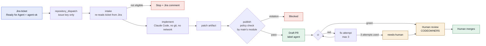

# agentic-devops-workflow

A Jira ticket marked "Ready for Agent" becomes a branch and a draft pull request written by Claude Code in GitHub Actions, followed by a bounded CI fix loop. A person always reviews and merges.



The core idea: no job holds both the agent and a write credential. The agent job can read the repo and call the Claude API. The job that can push cannot run the agent. Between them is a patch file, checked by code from `main`.

## Parts and where they live

| Part | Where |
|---|---|
| Ticket to PR workflow (intake, implement, publish, notify) | [.github/workflows/agent-ticket-to-pr.yml](.github/workflows/agent-ticket-to-pr.yml) |
| CI fix loop (triage, fix, publish, escalate) | [.github/workflows/agent-ci-fix.yml](.github/workflows/agent-ci-fix.yml) |
| Checks every PR must pass (checks, agent-policy, workflow-security) | [.github/workflows/ci.yml](.github/workflows/ci.yml) |
| AgentFlow module: ticket checks, task file, change policy, fix counter | [modules/AgentFlow/](modules/AgentFlow/) |
| Policy (allowed projects, protected paths, limits) | [modules/AgentFlow/policy.json](modules/AgentFlow/policy.json) |
| Workflow step scripts (intake, patch export and import, publish, triage, checks) | [scripts/](scripts/) |
| Agent rules and tool denies | [CLAUDE.md](CLAUDE.md), [.claude/settings.json](.claude/settings.json) |
| Review ownership | [.github/CODEOWNERS](.github/CODEOWNERS) |
| Sample product code that tickets change | [src/InventoryApi/](src/InventoryApi/) |
| Tests (product code and guard rails) | [tests/](tests/) |
| Design, runbook, security notes | [DESIGN.md](DESIGN.md), [RUNBOOK.md](RUNBOOK.md), [SECURITY.md](SECURITY.md) |
| Decisions, Jira setup, evidence, Confluence page | [docs/DECISIONS.md](docs/DECISIONS.md), [docs/JIRA_SETUP.md](docs/JIRA_SETUP.md), [docs/EVIDENCE.md](docs/EVIDENCE.md), [docs/confluence/agentic-devops-workflow.md](docs/confluence/agentic-devops-workflow.md) |

## Example ticket

`DEVOPS-42 Add Get-ReorderReport that lists SKUs at or below their reorder point`. The agent edits `src/InventoryApi`, adds tests under `tests/InventoryApi`, runs the check script, and the workflow opens a draft PR on a branch named `agent/DEVOPS-42-<slug of the summary>`. A fixture of this ticket is in [tests/AgentFlow/fixtures/jira-issue-DEVOPS-42.json](tests/AgentFlow/fixtures/jira-issue-DEVOPS-42.json).

## Prerequisites

| Tool | Version used | Needed for |
|---|---|---|
| PowerShell | 7.4+ | everything |
| Git | 2.30+ | patch export and import, tests |
| Pester | 5.9.1 (pinned) | tests |
| PSScriptAnalyzer | 1.25.0 (pinned) | lint |
| actionlint | 1.7.12 | workflow lint, optional locally |
| zizmor | 1.31.1 | workflow security lint, optional locally |
| GitHub account with Actions | n/a | running the workflows |
| Jira Cloud site with Automation | n/a | the trigger |
| Anthropic API key or an OIDC federation rule | n/a | Claude Code in the implement job |

## Quick start: local checks

```powershell
./scripts/Install-CheckTools.ps1                # installs pinned Pester and PSScriptAnalyzer for the current user
pwsh -NoProfile -File ./scripts/Invoke-Checks.ps1   # lint, then tests; exits 1 on any failure
```

Expected: PSScriptAnalyzer reports no errors or warnings, and 163 Pester tests pass in about 16 seconds. The same script runs in `ci` and is the only command the agent may run.

Workflow lint, if you have the tools:

```powershell
actionlint
zizmor --min-severity medium .github/workflows
```

## Set it up for real

Follow [RUNBOOK.md](RUNBOOK.md) for the GitHub App, environments, variables, labels and the `main` ruleset, then [docs/JIRA_SETUP.md](docs/JIRA_SETUP.md) for the Jira rule. Until that is done the workflows stay switched off, because the kill switch variable `AGENT_ENABLED` is not `true`.

## Status

Verified locally:

- PSScriptAnalyzer: zero findings.
- Pester: 163 tests pass.
- actionlint 1.7.12: clean.
- zizmor 1.31.1: no findings (one ignored with a written reason: `workflow_run` in `agent-ci-fix.yml`).
- A local end-to-end dry run of intake, patch and policy against a fixture ticket. See [docs/EVIDENCE.md](docs/EVIDENCE.md).

Not verified yet:

- A live run against Jira and the Claude API. It needs the GitHub App, the environment secrets and the Jira automation rule to exist first.
- The Atlassian connector in the build session could not reach the owensminor site, so the Jira side (status, label, automation rule, comments) has not been exercised.
- The repository rulesets (required checks, CODEOWNERS review, agent branch creation limited to the App) are written down in the runbook but not applied or tested.
- Claude authentication: both the OIDC federation path and the `ANTHROPIC_API_KEY` path are wired in the workflows, but neither has run.

Repository: `kaushik-sai/agentic-devops-workflow` (private for now).
