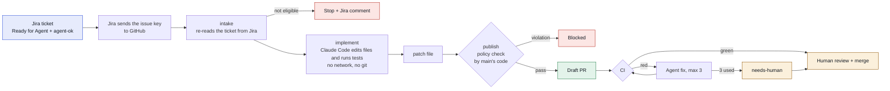

# Agentic DevOps workflow: Jira ticket to draft pull request

> Paste notes: this page is Markdown. In Confluence, use Insert, Markdown (or paste into the editor). The flow diagram is Mermaid; it needs the Mermaid macro (a Marketplace app such as "Mermaid Diagrams for Confluence"). Without it, paste the code block as a code snippet or attach a rendered image. Repository links need access to `kaushik-sai/agentic-devops-workflow`, which is private for now.

**Owner:** Kaushik (repository admin, CODEOWNERS)
**Status:** built and checked locally; not yet run against live Jira and the Claude API
**Repository:** `kaushik-sai/agentic-devops-workflow`

## Overview

A Jira ticket in the DEVOPS project can be handed to an AI agent (Claude Code, running in GitHub Actions). The agent writes the change, runs the tests, and a draft pull request appears. The ticket gets a comment with the link. If CI fails on the pull request, the agent tries to fix it up to 3 times. After that it labels the PR `needs-human` and stops.

A person always reviews and merges. The agent cannot merge, approve, release or deploy.

Good fit: small, clear tasks and bugs in the sample product code (`src/InventoryApi`). Poor fit: large changes, unclear requests, changes to the pipeline or to security settings.

## How it works

In words:

1. A person moves a DEVOPS ticket to **Ready for Agent** and the ticket has the label **agent-ok**.
2. Jira Automation sends only the ticket key to GitHub.
3. **Intake** reads the ticket from Jira again and checks the project, status, label and issue type. If something is wrong, the ticket gets a comment saying why.
4. **Implement**: Claude Code reads the task and edits files. It can read, edit, search and run the repository's check script. It has no network access through its tools and cannot use git. It holds no Jira token and no write access to GitHub.
5. **Publish**: a separate job takes the patch and checks it against the policy (protected files, size limit) using the code on `main`. Only then does it get a short-lived token from a GitHub App, push a branch, and open a **draft** pull request labelled `agent`.
6. **Notify**: the Jira ticket gets a comment with the PR link, or with the run link if something failed.
7. **CI** runs on the PR like any other. If it fails, the **fix loop** starts (up to 3 attempts).
8. A reviewer reads the diff and merges, or sends it back.

## Roles and responsibilities

| Role | Responsible for |
|---|---|
| Ticket author | Writes a clear summary and description with acceptance criteria. Keeps secrets and credentials out of tickets. |
| Ticket approver (anyone allowed to set Ready for Agent and agent-ok) | Decides a ticket is suitable for the agent. This is the start button. |
| Reviewer (CODEOWNERS) | Reads the whole diff. Checks the change does what the ticket asks and nothing more, tests were not weakened, no new dependencies without reason. Merges. |
| Repository owner | Owns the workflow, policy and secrets. Rotates keys. Handles `needs-human` PRs and incidents. Changes guard-rail files (the agent cannot). |
| Jira admin | Maintains the DEVOPS project, the Ready for Agent status, the service account and the automation rule. |
| The agent | Implements the ticket, adds tests, writes a summary. Nothing else. |

## How to request agent work

1. Create a ticket in project **DEVOPS**. Type: Task, Bug or Story.
2. Write it so a new colleague could do it without asking questions:
   - A one-line summary in the form "Add X that does Y".
   - A description with the expected behaviour, and where in the code it belongs if you know.
   - What done looks like (for example, "a function that returns the SKUs at or below their reorder point, with tests").
3. Add the label **agent-ok**.
4. Move the ticket to **Ready for Agent**.
5. Wait for a comment on the ticket. It links to a draft PR, or explains why the run did not produce one.

Example: `DEVOPS-42 Add Get-ReorderReport that lists SKUs at or below their reorder point`.

Do not put secrets, passwords or personal data in the ticket. Do not ask the agent to change workflows, security settings, the agent's rules or dependencies; the policy blocks those paths.

To rerun a ticket, ask the repository owner to delete the old branch first. A rerun does not overwrite earlier work, on purpose.

## Guard rails

- **Only listed tickets:** project DEVOPS, status Ready for Agent, label agent-ok, type Task, Bug or Story. Checked again at run time against Jira.
- **Separate jobs, separate secrets:** the job with the agent has no way to push or read Jira. The job that can push never runs the agent.
- **Limited tools:** the agent can read, edit, search and run one check script. No internet tools, no git, no shell otherwise.
- **Protected files:** the agent cannot change workflows, `.claude`, `CLAUDE.md`, CODEOWNERS, the agent module, scripts, the guard-rail tests, or key and `.env` files.
- **Size limit:** at most 25 files and 800 lines per change.
- **Checked twice by code the agent cannot change:** at publish, and again by the `agent-policy` CI job.
- **Draft PRs, required review:** CODEOWNERS approval and passing checks are required on `main`. The agent never merges.
- **Bounded fix loop:** 3 attempts, counted in git history.
- **Controls:** a kill switch (`AGENT_ENABLED`), one run per ticket at a time, time and turn limits, optional manual approval per run.
- **Pinned tooling:** actions pinned by commit, checked tool downloads, weekly Dependabot updates.

## FAQ

**Can the agent merge or deploy?**
No. It opens draft PRs only. A person approves and merges.

**What if the ticket contains instructions meant to trick the agent?**
Ticket text is treated as data and fenced in the task file. The agent has no secrets and no write access, and the policy blocks protected files. A reviewer still reads the diff. If the agent notices an injection attempt it is told to report it in its summary.

**What can the agent change?**
Product code under `src/` and tests under `tests/` (except the guard-rail tests). Up to 25 files and 800 lines.

**The ticket did not start. Why?**
Read the Jira comment from the agent; it lists the reasons (wrong status, missing label, wrong type, project not allowed). If there is no comment, the kill switch may be off or the Jira rule may not have fired. Ask the repository owner.

**CI failed on the agent's PR. What happens?**
The agent gets the failed log and tries a fix, up to 3 times. After the third failed fix the PR is labelled `needs-human` and the ticket is told. Then a person takes over.

**Can I push to an agent branch myself?**
Yes. The agent's fix pushes are fast-forward only, so it will not overwrite your commit. The attempt counter does not reset.

**How do I stop the agent?**
Ask the repository owner to set `AGENT_ENABLED` to `false`, or disable the Jira automation rule.

**How do I tell what the agent did?**
Open the PR: the body has the agent's summary, a link to the run, and a review checklist. Commits carry `Jira:` and `Agent-Run:` trailers.

**What does it cost?**
Each run uses the Claude API for up to 40 turns (30 for fixes). Costs are bounded by turn and time limits and a spend limit set in the Anthropic console.

**Has this been tested for real?**
The code, checks and policy are tested locally (163 unit tests, workflow lint and security lint, and a local dry run of intake to patch to policy). A full run against live Jira and the Claude API has not been done yet.

## Further reading

In the repository: `README.md`, `DESIGN.md`, `RUNBOOK.md`, `SECURITY.md`, `docs/DECISIONS.md`, `docs/JIRA_SETUP.md`.
